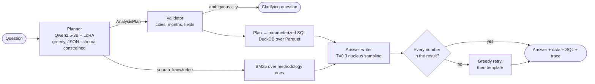

# Housing Market AI Analyst

Ask questions about U.S. city home values (Zillow ZHVI) and rents (ZORI) in plain English: "Rank
Colorado cities by home value growth in 2025", "When did Mead, CO's home values peak?", "What is
ZORI and how is it smoothed?". A **fine-tuned 3B model plans** each analysis as a typed plan;
**trusted code** validates it against the data, compiles it to parameterized SQL, and computes
every number. The model never writes SQL and never supplies a number the data doesn't contain.



## Results

On the frozen 200-case eval set ([docs/evaluation.md](docs/evaluation.md)):

| Model | Execution accuracy | Turn success | Valid first output |
|---|---:|---:|---:|
| Llama-3.2-3B-Instruct (base) | 27.5% | 37.5% | 79.0% |
| Qwen2.5-3B-Instruct (base) | 51.1% | 55.5% | 94.0% |
| **Qwen2.5-3B + LoRA** (data v2) | **89.3%** | **92.5%** | **100.0%** |

Execution accuracy runs the predicted and gold plans and compares the results (131 data cases);
turn success also scores clarifications, refusals, and methodology answers. On eval v1.1, which
corrects four gold plans, the fine-tuned model scores 92.1% and 94.5%.

The app runs on AWS: the API and the Streamlit UI on one EC2 instance, calling the model on a
SageMaker endpoint.

## Documentation

| Document | Contents |
|---|---|
| [docs/architecture.md](docs/architecture.md) | Components, one turn step by step, trust boundary, design decisions and trade-offs |
| [docs/model.md](docs/model.md) | Base model choice, validator-filtered training data, LoRA configuration, training results |
| [docs/sampling.md](docs/sampling.md) | Decoding per step, how constrained decoding works, the grounding check, measured effects |
| [docs/evaluation.md](docs/evaluation.md) | Eval set, metrics, every run, per-family results, error analysis |
| [docs/api.md](docs/api.md) | Endpoints, request and response fields, examples, status codes |
| [docs/app-deployment.md](docs/app-deployment.md) | Runbook: the app on EC2 (what's created, cost, security, troubleshooting) |
| [docs/deployment.md](docs/deployment.md), [docs/training.md](docs/training.md) | Runbooks: the SageMaker endpoint and evaluation; the LoRA training job |
| [docs/demo.md](docs/demo.md) | Demo script: checklist, the six questions and what to point out, fallbacks; slides in [docs/slides/](docs/slides/) |

## Quick start (no AWS needed)

```bash
uv sync --python 3.12

# 1. Put the Zillow city CSVs in datasets/ (git-ignored), then build the versioned dataset:
uv run python scripts/ingest_zillow.py \
    --zhvi datasets/City_zhvi_uc_sfrcondo_tier_0.33_0.67_sm_sa_month.csv \
    --zori datasets/City_zori_uc_sfrcondomfr_sm_sa_month.csv \
    --data-dir data

# 2. Run the tests (they use a synthetic fixture, not the real files)
uv run pytest
uv run ruff check .
```

## Run the API

```bash
# Offline, with the deterministic stub model (no AWS):
MODEL_BACKEND=stub uv run uvicorn api.main:app --port 8000
# Against a deployed SageMaker TGI endpoint:
MODEL_BACKEND=sagemaker SAGEMAKER_ENDPOINT_NAME=<name> AWS_REGION=us-east-2 \
    uv run uvicorn api.main:app --port 8000

curl -s localhost:8000/health   # liveness: always 200 while the app is up
curl -s localhost:8000/ready    # readiness: 503 when the model endpoint isn't InService
curl -s localhost:8000/v1/ask -H 'content-type: application/json' \
    -d '{"question": "Rank Colorado cities by ZHVI growth in 2025", "include_rows": false}'
```

Interactive API docs: <http://localhost:8000/docs>. Set `API_KEY` to require an `X-API-Key` header.

## Run the UI

The Streamlit UI is a client of the API: start the API first (above), then

```bash
uv run streamlit run ui/app.py        # opens http://localhost:8501
```

Set `ANALYST_API_URL` (default `http://localhost:8000`) and, if the API has one, `ANALYST_API_KEY`.
Ask in the sidebar or pick an example. Each answer has three tabs: **AI response** (warnings,
answer, headline numbers, chart), **Queried data** (every row, with CSV download), and **Evidence &
trace** (dataset version, resolved cities, the SQL and its parameters, the model's plan, knowledge
sources, and the tool events with timings). With `MODEL_BACKEND=stub`, the example questions are
answered by fixed rules, so the whole UI works without AWS.

## Run in containers

```bash
docker compose up --build             # API on :8000, UI on :8501; stub model, ./data mounted read-only
```

Two images are built from one [Dockerfile](Dockerfile): `api` (no Streamlit) and `ui` (only the UI
packages). Settings come from the environment or a git-ignored `.env`. To deploy on AWS (one EC2
instance calling the SageMaker endpoint), see [docs/app-deployment.md](docs/app-deployment.md).

## Layout

| Path | Role |
|---|---|
| `housing/ingest.py` | Wide Zillow CSV → validated long Parquet + manifest; activates only after validation |
| `housing/db.py` | Read-only DuckDB view over the active dataset version; coverage and region index |
| `tools/schemas.py` | `AnalysisPlan` and tool-call envelope (JSON Schema for prompts + constrained decoding) |
| `tools/resolve.py` | City resolution: exact match, ambiguity reporting, fuzzy suggestions |
| `tools/validator.py` | Data-aware validation → `ValidatedPlan` or a typed `ToolError` |
| `tools/compiler.py` | `ValidatedPlan` → parameterized SQL |
| `tools/operations.py` | Operation registry: series, change, yoy_change, extrema, rank, aggregate, coverage |
| `agent/decoding.py` | Decoding profiles per agent step (greedy+constrained plans, nucleus answers) |
| `agent/model_clients/` | Model-client interface, deterministic stub, SageMaker TGI client |
| `agent/prompts.py` | Planner and answer-writer prompts (catalog injected) |
| `agent/orchestrator.py` | Bounded agent loop: plan → validate → execute → answer, with retries |
| `agent/grounding.py` | Numeric-faithfulness check, template answers, clarification text |
| `rag/corpus/` | Methodology knowledge base (ZHVI, ZORI, coverage, scope) with source citations |
| `tools/knowledge.py` | BM25 retrieval over the corpus for `search_knowledge` |
| `api/main.py` | FastAPI: `POST /v1/ask`, `GET /v1/catalog`, `GET /health`, `GET /ready` |
| `ui/` | Streamlit UI (`app.py`), its API client (`client.py`), and display helpers (`view.py`) |
| `evaluation/` | Frozen eval set (200 cases), oracle, scorer, runner — see [evaluation/README.md](evaluation/README.md) |
| `scripts/run_eval.py` | Score a model backend (`oracle`, `stub`, `sagemaker`) on the eval set |
| `Dockerfile`, `docker-compose.yml` | Container images (`api`, `ui`) and the two-service app |
| `scripts/deploy_app.py` | Deploy / check / stop / tear down the app on EC2 — see [docs/app-deployment.md](docs/app-deployment.md) |
| `scripts/deploy_endpoint.py` | Deploy / check / delete the SageMaker TGI endpoint — see [docs/deployment.md](docs/deployment.md) |
| `scripts/smoke_endpoint.py` | Check a live endpoint against the decoding settings the agent relies on |
| `training/` | Step 3 planner training data: phrase grammar, filters, train/dev split — see [training/README.md](training/README.md) |
| `scripts/build_training_data.py` | Build the training data and its report |
| `training/job/train.py` | SageMaker training job: LoRA on Qwen2.5-3B, completion-only loss, in-job merge |
| `scripts/launch_train.py` | Launch the training job from Studio — see [docs/training.md](docs/training.md) |

## Example

```python
from housing.db import HousingDB
from tools.validator import PlanValidator
from tools.operations import execute

db = HousingDB("data")
plan = {
    "metric": "zhvi",
    "state_filter": "CO",
    "start_month": "2025-01",
    "end_month": "2025-12",
    "operation": "rank",
    "rank_by": "pct_change",
    "limit": 5,
}
result = execute(PlanValidator(db).validate(plan), db)
print(result.summary["top"], result.warnings)
```

Data: [Zillow Research](https://www.zillow.com/research/data/), used for non-commercial coursework.
