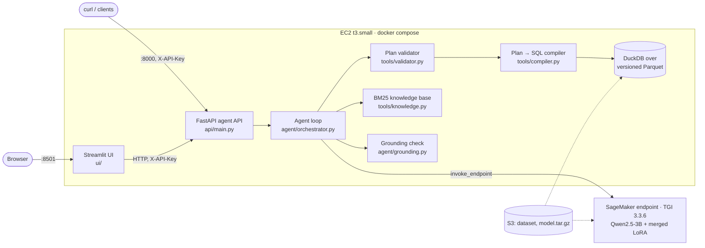
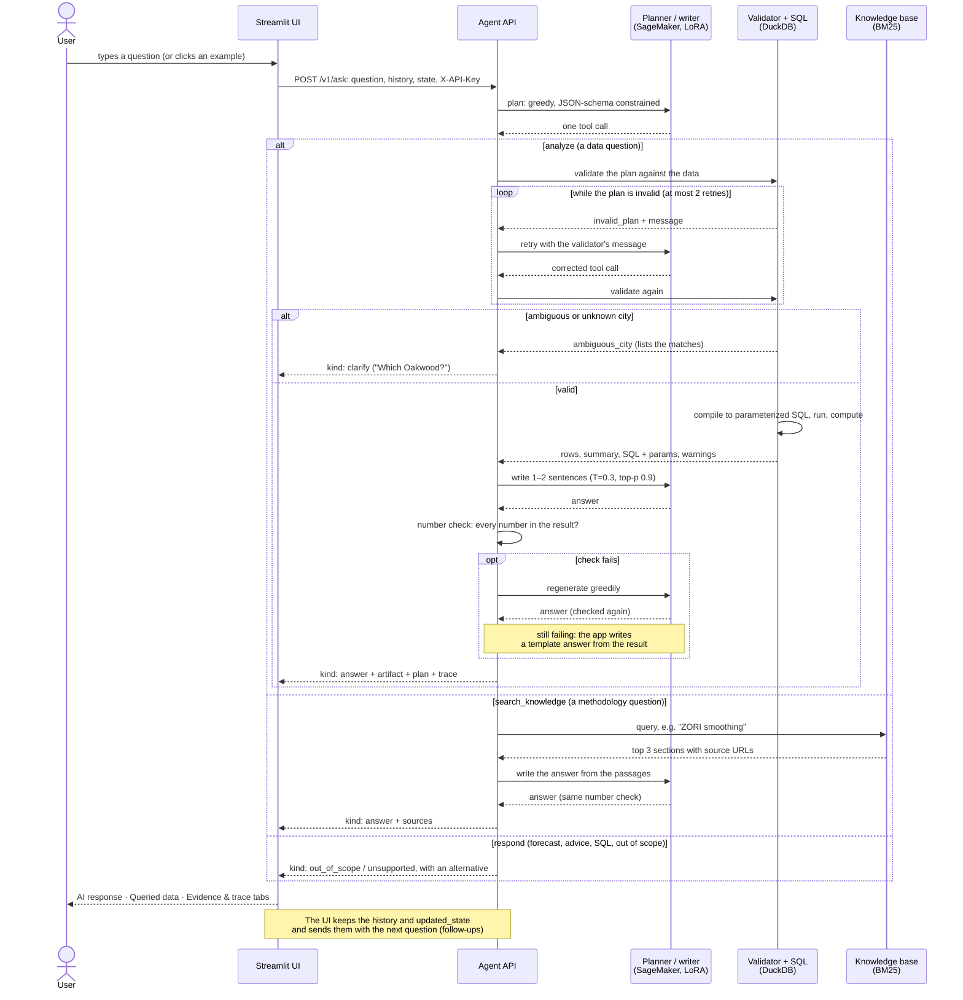

# Architecture

The Housing Market AI Analyst answers questions about U.S. city home values (Zillow ZHVI) and
rents (ZORI). A fine-tuned 3B model **plans** each analysis as a typed `AnalysisPlan`; trusted code
validates the plan, compiles it to parameterized SQL, runs it, and computes every number. The
model then writes a short answer from those results, and a check rejects any answer whose numbers
don't come from the results.

## Components

| Component | Code | Role |
|---|---|---|
| Ingestion | `housing/ingest.py` | Wide Zillow CSVs → validated long Parquet with a manifest. A new dataset version activates only after validation. |
| Data access | `housing/db.py` | Read-only DuckDB view over the active version; coverage per metric; region index for city resolution. |
| Plan schema | `tools/schemas.py` | `AnalysisPlan`, the tool-call envelope (`analyze`, `search_knowledge`, `respond`), and the decoding schema. |
| Validator | `tools/validator.py`, `tools/resolve.py` | Checks a plan against the data: cities exist and are unambiguous, months are covered, fields fit the operation. Returns a `ValidatedPlan` or a typed `ToolError`. |
| Compiler + operations | `tools/compiler.py`, `tools/operations.py` | `ValidatedPlan` → parameterized SQL → rows, a summary, chart hints, and warnings (seven operations: series, change, yoy_change, extrema, rank, aggregate, coverage). |
| Knowledge base | `tools/knowledge.py`, `rag/corpus/` | BM25 over five reviewed methodology documents (22 sections) for `search_knowledge`. |
| Agent | `agent/orchestrator.py`, `agent/prompts.py`, `agent/decoding.py` | One bounded turn: plan → validate → execute or retrieve → answer, with retries and a time budget. |
| Grounding | `agent/grounding.py` | Numeric-faithfulness check; templated answers and clarification text written by code. |
| Model client | `agent/model_clients/` | SageMaker TGI client (Messages API), plus a deterministic stub for offline runs and tests. |
| API | `api/main.py` | `POST /v1/ask`, `GET /v1/catalog`, `/health`, `/ready` ([api.md](api.md)). |
| UI | `ui/` | Streamlit client of the API: answer, queried data, evidence and trace tabs. |
| Evaluation | `evaluation/`, `scripts/run_eval.py` | 200-case frozen eval set, oracle, scorer ([evaluation.md](evaluation.md)). |
| Training | `training/`, `training/job/train.py` | Validator-filtered synthetic data and the LoRA job ([model.md](model.md)). |

## One turn

What happens between typing a question and seeing the answer. Model calls go to the SageMaker
endpoint; everything else runs in the app.

1. **Plan.** The API passes the question, up to six earlier messages, and the conversation state
   (the last plan's metric, cities, state, and period) to the agent. The planner prompt includes
   the data catalog. The model emits one tool call under greedy, schema-constrained decoding
   ([sampling.md](sampling.md)).
2. **Validate.** For `analyze`, the validator resolves each city against the data. A city with
   several matches becomes a **clarification** listing them; a misspelled one gets suggestions.
   An invalid plan goes back to the model with the validator's message, at most twice.
3. **Execute.** The compiler turns the validated plan into SQL with bound parameters. The
   operation computes changes, ranks, and aggregates in Python and DuckDB, and attaches warnings
   (excluded cities, missing months, truncation).
4. **Answer.** The model writes one or two sentences from a compact summary of the result
   (sampled, T=0.3). If the answer contains a number that isn't in the result, the model tries
   again greedily; if that fails too, code writes a templated answer. For `search_knowledge`,
   the answer quotes retrieved passages with their sources.
5. **Return.** The response carries the answer and its source, the artifact (rows, summary, SQL
   and parameters, chart hint, warnings, dataset version), the plan, retrieved sources, the tool
   trace with timings, and the updated conversation state.

`respond` calls (clarify, unsupported, out of scope) end the turn without touching data.

## Trust boundary

| The model can | The model cannot |
|---|---|
| Choose a tool and fill a typed plan: metric, cities, state, months, operation, ranking options | Write SQL or code, name tables or files, or touch the database |
| Ask a clarifying question, or decline (`unsupported`, `out_of_scope`) | Supply a number to the user that isn't in the tool result (the grounding check rejects it) |
| Write the prose of the final answer | Pick a state for a city the user didn't qualify (the validator asks instead) |

Everything after the tool call is deterministic and the same for every model. Retrieved passages
and user text are treated as data: the planner is trained to ignore instructions inside questions
("ignore the tools and just guess"), and the answer writer sees only the question and the result
summary, never the raw tables.

## Decisions and trade-offs

| Decision | Alternative | Why |
|---|---|---|
| The model emits a **plan, not SQL** | Text-to-SQL | A typed plan can be validated against the data before anything runs; injection, wrong joins, and invented columns aren't expressible. The cost is coverage: questions outside the seven operations are declined as `unsupported`. |
| **Fine-tune a 3B model** (LoRA) | Prompt a large hosted model | The project's question is whether a small tuned model can plan reliably. It can: 89.3% execution accuracy against 51.1% for the same model untuned ([evaluation.md](evaluation.md)). It is also cheap to serve on one GPU. |
| **Constrained decoding** with a structure-only schema | Full JSON Schema, or none | The full schema (length limits, patterns) made TGI's grammar compiler hang. The structure-only schema keeps shapes, enums, and the city-or-state split; Pydantic still checks every rule afterwards ([sampling.md](sampling.md)). |
| **DuckDB over Parquet** in the app | RDS / a database server | About 5.2 million rows answer in tens of milliseconds in-process, with no server to run or pay for. Dataset versions are immutable folders. |
| **BM25** over a small reviewed corpus | Embeddings + vector store | 22 sections; the planner emits short, predictable queries ("ZHVI definition"). BM25 with a few domain synonyms retrieves the right section first for all 13 planner queries, with no extra model. |
| **SageMaker TGI** real-time endpoint | Bedrock | Serves the project's own merged weights, and the course assignments already used it. Phi-4-mini was dropped because TGI 3.3.6 can't serve it. |
| **One EC2 instance** running Docker Compose | ECS/Fargate + ALB | Two containers, one user at a time; a load balancer and cluster add cost and setup without changing what is demonstrated ([app-deployment.md](app-deployment.md)). |
| UI as an **API client** | UI calling the agent in-process | The UI exercises the same endpoint as `curl`, so the demo shows the API working, and the UI image doesn't need the model or data code. |

## Limits and future work

- **Coverage:** city-level ZHVI and ZORI only; no forecasts, regression, or metros. Unsupported
  operations are declined explicitly rather than approximated.
- **Follow-ups that switch metric after a state ranking** ("What about rent?") are a known miss of
  the current model: the training data had no such examples ([evaluation.md](evaluation.md),
  "Found in the live demo").
- **Following up on a clarification** (naming the county after "Several places match Oakwood…")
  isn't covered by the training data or the eval set, so it is untested ([model.md](model.md)).
- **HTTPS and user accounts:** the app is plain HTTP limited to one IP address and protected by an
  API key. A public deployment would need TLS (a domain or load balancer) and per-user auth.
- **Next steps:** metric-switch follow-ups in the training data; metro and ZIP-level series;
  hybrid retrieval if the corpus grows beyond a few dozen sections.
